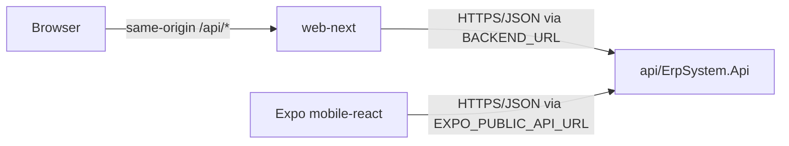

# ERP System

This repository contains the ASP.NET Core API, the supported Next.js browser
client, and the Expo/React Native mobile client for an ERP System. General
Data (ReferenceData), Accounting, HR, CRM, and Reporting are the currently
supported business areas, on a Platform foundation with Contacts, Inventory, and
PointOfSale module foundations; new activities are added as independent modules.

## Start here

For any new module or feature, begin with the general
[ERP documentation guide](documentation/guides/shared/ERP_DOCUMENTATION_GUIDE_AR.md),
and the [shared reuse catalog](documentation/guides/shared/SHARED_REUSE_CATALOG.md),
then inspect the owning module package under `documentation/modules/`. HR books
remain valid references for their own capabilities; they are not global ERP
requirements.

## Application Ownership

| Application | Status | Purpose |
| --- | --- | --- |
| `api/ErpSystem.Api/` | Active | ERP backend API host |
| `web-next/` | Canonical | Supported frontend and deployment target |
| `mobile-react/` | Active | Supported Expo/React Native mobile client |
| `api/ErpSystem.AttendanceConnector/` | Active (Windows companion) | Local attendance-device connector (`net10.0-windows`, x86 COM driver). Run with `scripts/Start-AttendanceDevelopment.ps1`; kept outside `ErpSystem.sln` because it builds only on Windows x86 |
| `packages/tokens/` | Active | Shared design tokens for web and mobile |

New browser features target `web-next/`; new mobile features target
`mobile-react/`. Shared business and HTTP contracts remain owned by the API.

## API And Frontend Relationship

`web-next` and `mobile-react` are supported clients of
`api/ErpSystem.Api`. Browser API requests use the same-origin `/api/*`
path and pass through the Next.js proxy at
[`web-next/src/app/api/[...path]/route.ts`](web-next/src/app/api/%5B...path%5D/route.ts).
The proxy resolves the backend origin from `BACKEND_URL`. Mobile requests use
the centralized Axios/API service and resolve the backend from
`EXPO_PUBLIC_API_URL`.

The relationships are recorded in
[`architecture/application-relation.ts`](architecture/application-relation.ts),
including canonical project paths and transport owners. Graphify indexes the
API, browser and mobile clients.

## Main Projects

- Backend: `api/ErpSystem.Api/` (solution: `api/ErpSystem.sln`)
- Backend modules: `api/Modules/<Module>/` (Platform, ReferenceData, Contacts,
  Accounting, HR, CRM, Inventory, PointOfSale, Reporting); each uses
  the canonical Contracts, Domain, Application, Infrastructure, Presentation,
  and Bootstrap projects.
- Browser frontend: `web-next/`
- Mobile frontend: `mobile-react/`
- Centralized project documentation: `documentation/`

The canonical three-project Countries implementation review is
[`documentation/modules/reference-data/features/countries/countries-review.md`](documentation/modules/reference-data/features/countries/countries-review.md).
The reusable review workflow and source manifest are indexed from
[`documentation/system/README.md`](documentation/system/README.md).
