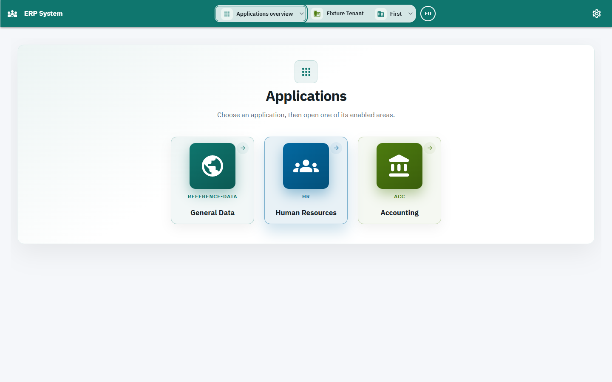
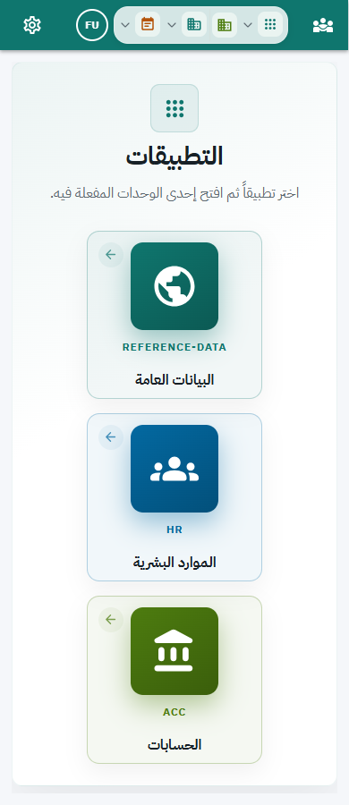

# اختيار التطبيق من الشريط العلوي

هذه الإرشادات تخص S2-A6 بعد قبول Phase06 بتاريخ2026-10-29.

## الفائدة والمتطلبات

يمكنك الانتقال بين التطبيقات المسموحة لحسابك والعودة إلى نظرة التطبيقات العامة
من الشريط العلوي، مع الاحتفاظ باختيار الشركة وسنة العمل لدى مالكيهما.
يلزم تسجيل الدخول بحساب داخل منشأة وله تطبيقات متاحة. حساب إدارة المنصة العام
يستخدم واجهته الخاصة ولا تظهر له قائمة تطبيقات المنشأة.

## الاستخدام

1. افتح قائمة التطبيق في الشريط؛ على الشاشة الصغيرة تظهر بأيقونة التطبيقات.
2. اختر التطبيق المطلوب، مثل الموارد البشرية أو الحسابات.
3. لعرض جميع التطبيقات، اختر «نظرة عامة على التطبيقات».
4. عند فتح قسم داخل التطبيق أو الرجوع في المتصفح، يعكس الشريط التطبيق المفتوح.
5. بلوحة المفاتيح: انتقل إلى المحدد بـTab، افتحه بـSpace، تحرك بالأسهم أو Home/End،
   اختر بـEnter، وأغلق بدون اختيار بـEscape.
6. على الكمبيوتر تظهر أسماء التطبيق والمنشأة والشركة والسنة كاملة. على الشاشات
   الصغيرة أو عند ضيق مساحة الشريط تظهر الأيقونات؛ مرر المؤشر لمعرفة الاسم.
7. للتمرير استخدم عجلة الماوس أو اسحب المقبض الرفيع. يمكن التركيز على منطقة
   المحتوى بـTab واستخدام PageDown وHome. ألوان السكرول تتبع لون وثيم التطبيق.

## الحالات الشائعة

- تظهر التطبيقات المسموحة فقط؛ اختيار تطبيق لا يضيف صلاحية ولا يغير الشركة.
- أثناء تحديث الشركة أو سنة العمل انتظر اكتمال العملية قبل تبديل التطبيق.
- عند تعذر تحميل التطبيقات استخدم زر إعادة المحاولة المجاور للقائمة أو داخل الصفحة.
- إذا رُفض فتح مسار، يمكنك العودة للنظرة العامة واختيار تطبيق مسموح.
- عند فشل الانتقال يبقى التطبيق السابق محددًا وتظهر رسالة يمكن إغلاقها.
- عدم وجود تطبيقات متاحة يستلزم مراجعة مسؤول المنشأة؛ لا تُنشئ القائمة صلاحيات.
- بعض شاشات الأعمال ما زالت ضمن مراحل التحويل؛ ظهور التطبيق لا يعني اكتمال كل شاشاته.

## أمثلة وصور آمنة

الصور من بيانات تحقق اصطناعية، ولا تحتوي بيانات عملاء أو رموز جلسة.

## أسئلة ومصطلحات

**التطبيق الحالي:** التطبيق الموافق للمسار المفتوح. **النظرة العامة:** صفحة التطبيقات المسموحة.
تبديل التطبيق لا يسجل خروجك. اختيار الشركة والسنة المالية عمليتان منفصلتان.
إذا غاب تطبيق متوقع، راجع إتاحته لحسابك والمنشأة مع المسؤول.

## مخطط فيديو ودعم العملاء

سجّل بحساب تجريبي، ثم اعرض: فتح القائمة، الانتقال لتطبيق، فتح قسم والرجوع،
العودة للنظرة العامة، استخدام لوحة المفاتيح، ثم عرض العربية والهاتف وحالة خطأ
اصطناعية وإعادة المحاولة. اشرح الفرق بين التطبيق والشركة والسنة. راجع التسجيل
لإخفاء بيانات الحساب والعملاء وأي أدوات مطور/طلبات مصادقة. لا تسجل كلمة مرور
أو Cookie أو JWT. لا حاجة لبيانات أعمال جديدة لهذا السيناريو.
